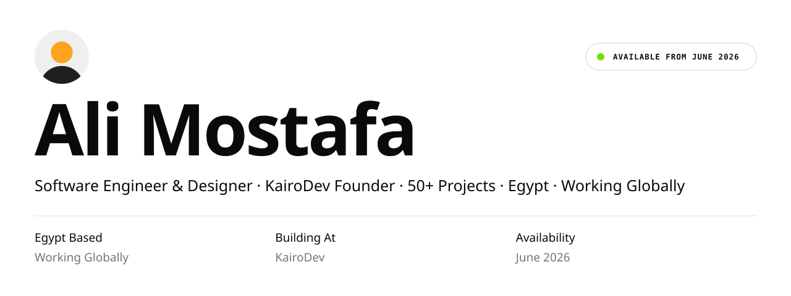
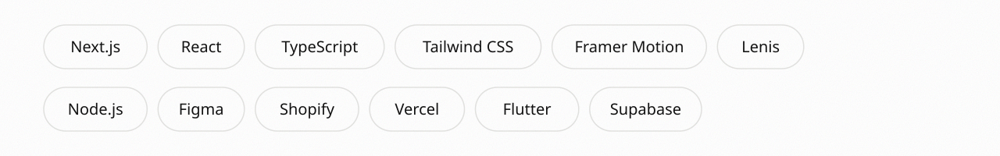
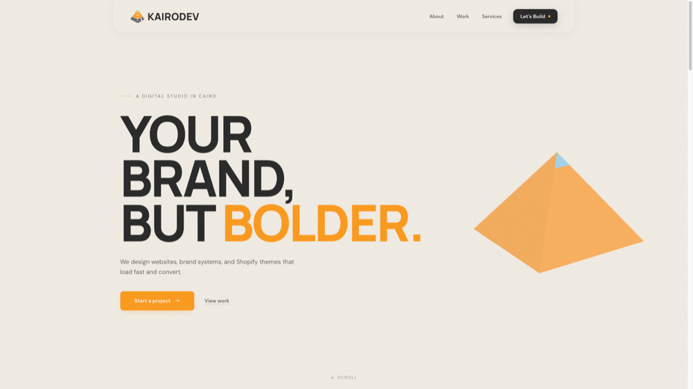
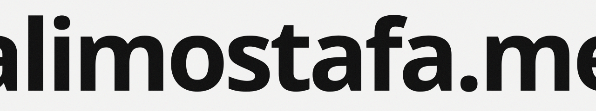

<picture>
  <source media="(prefers-color-scheme: dark)" srcset="assets/header-dark.svg">
  
</picture>

I'm **Ali Mostafa Aboueyana** — a software engineer and designer from Cairo, Egypt, driven by the space where design meets engineering. Since **2022** and across **50+ projects**, I've developed an eye for motion, performance, and the details most overlook — turning ambitious ideas into digital products that feel intentional and alive.

I run **[KairoDev](https://www.kairodev.com)** — a design-engineering studio building websites, Shopify themes, AI content, mobile apps, and presentations across the MENA region and beyond. This profile, like [alimostafa.me](https://alimostafa.me), is built the same way as everything else: fast, motion-rich, and a little obsessive about the details.

  <a href="https://alimostafa.me">🌐 alimostafa.me</a> ·
  <a href="https://www.kairodev.com">🏛️ KairoDev</a> ·
  <a href="https://www.linkedin.com/in/aly-aboueyana">💼 LinkedIn</a> ·
  <a href="https://instagram.com/alimostafa.me">📸 Instagram</a> ·
  <a href="mailto:a.aboueyana@gmail.com">✉️ Email</a>

<strong><code>STACK</code></strong>

<picture>
  <source media="(prefers-color-scheme: dark)" srcset="assets/stack-dark.svg">
  
</picture>

<strong><code>SELECTED WORK</code></strong>

  
<b>KairoDev</b> · Studio Website · 2026 
Studio site for KairoDev — websites, brand systems, and Shopify themes that load fast and convert. Next.js + a design system built for motion.

<strong><code>EXPERIENCE</code></strong>

- 🟠 **KairoDev** — *Founder · Software Engineer · Data Analyst · Designer* · **Now**
  - A design-engineering studio out of Cairo shipping production-ready products across MENA — websites, Shopify themes, mobile apps, and presentations.
  <!-- - Built [alimostafa.me](https://alimostafa.me): Next.js, TypeScript, Tailwind, Framer Motion, Lenis — light/dark themes, view transitions, and a lot of grain. -->
- 🔵 **ivend by mobica** — *Software Engineering & Data Analysis Intern* · Feb – Aug 2026
  - Redesigned ivend.cloud, driving a **+11.8% increase in impressions** over March–June 2026.
  - Shipped a new iOS & Android app in Flutter, plus a full UI overhaul of the vending-machine app.
  - Built weekly & daily Power BI / PDF reports from machine sales data — and presented the company's summer strategy & analytics directly to the CEO.

<!-- <h3 align="center"><code>OPEN SOURCE</code></h3>

- [**Bus-Tracking-App**](https://github.com/AliMostafaa/Bus-Tracking-App) — real-time university bus tracking with GPS, delay alerts, student–driver messaging, and admin route management _(Node.js, Next.js, MongoDB, Google Maps API)_
- [**EmotionDetection**](https://github.com/AliMostafaa/EmotionDetection) — real-time facial emotion detection using OpenCV and an ML classifier _(Jupyter Notebook, Python)_
- [**HayyGov**](https://github.com/AliMostafaa/HayyGov) — neighborhood-connect civic app: announcements, issue reporting, and local government channels _(Flutter, Dart)_
- [**UpSkillr-learning-V1**](https://github.com/AliMostafaa/UpSkillr-learning-V1) — e-learning platform connecting learners and instructors _(TypeScript)_
- [**PersonalFinancetracker**](https://github.com/AliMostafaa/PersonalFinancetracker) · [**space-task-manager**](https://github.com/AliMostafaa/space-task-manager) — finance & task tooling _(JavaScript)_ -->

<strong><code>NOW</code></strong>

> **Available since June 2026** — taking on freelance engagements globally. If something here is the kind of thing you're building, [reach out ✉️](mailto:a.aboueyana@gmail.com).

<!-- <picture>
  <source media="(prefers-color-scheme: dark)" srcset="assets/wordmark-dark.svg">
  
</picture> -->

Cairo, Egypt · Working globally — designed & built based on <a href="https://alimostafa.me">alimostafa.me</a> · © 2026 Ali Mostafa

